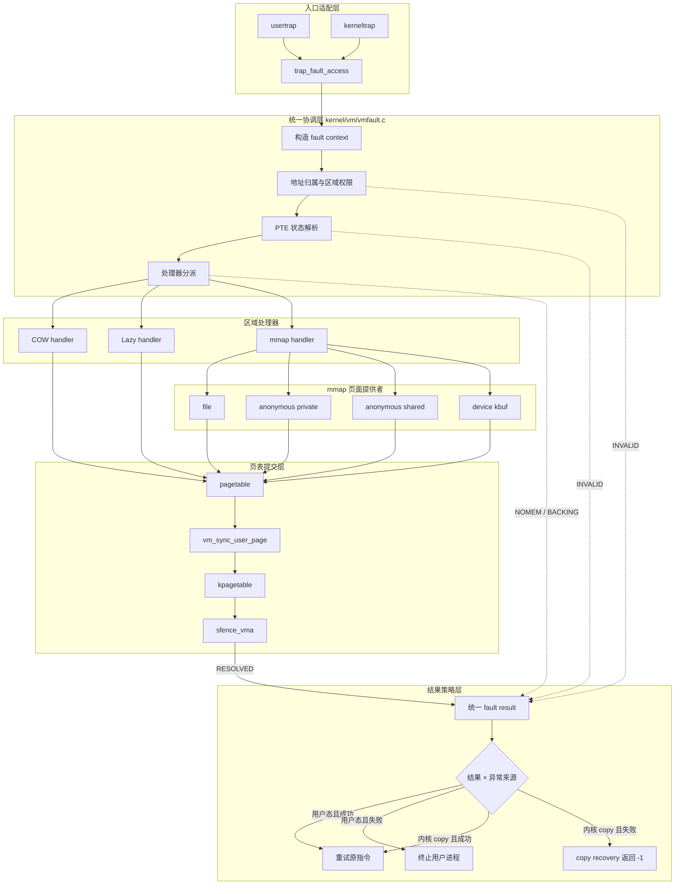
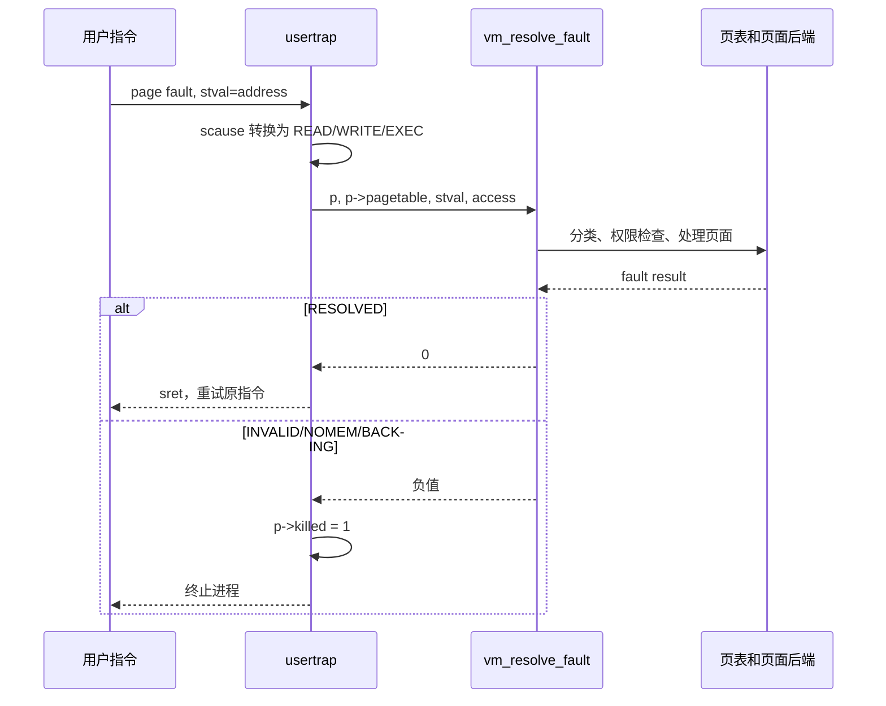
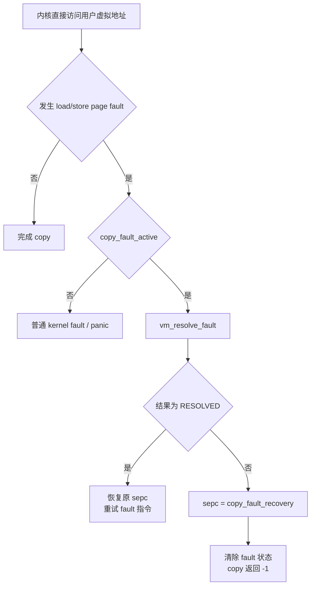
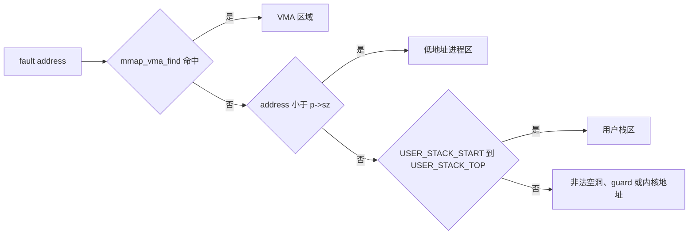
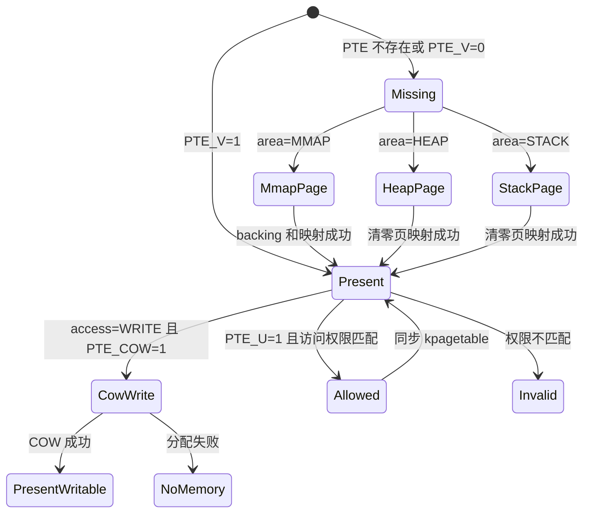
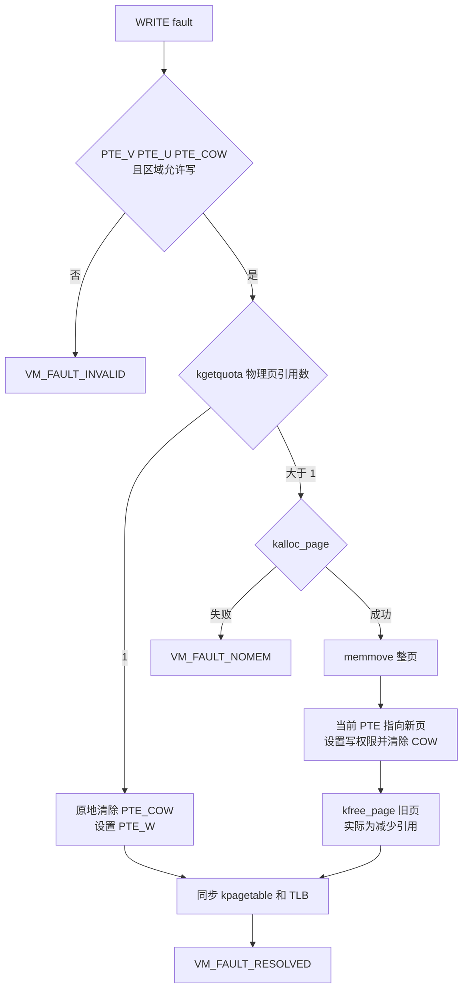
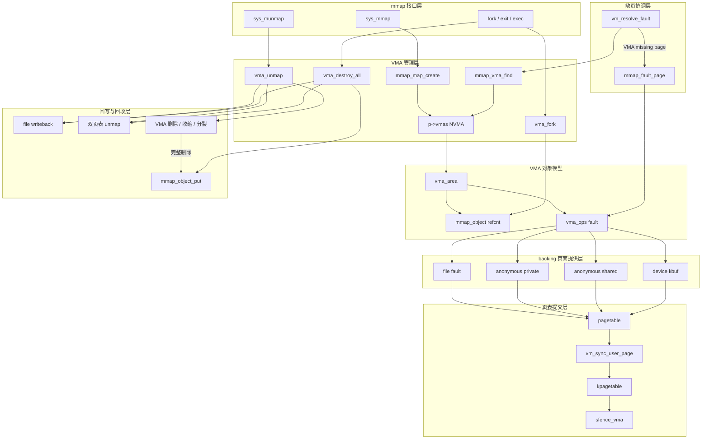
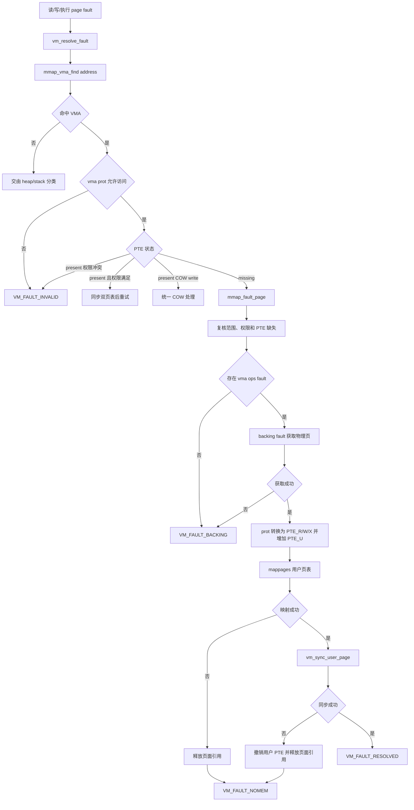
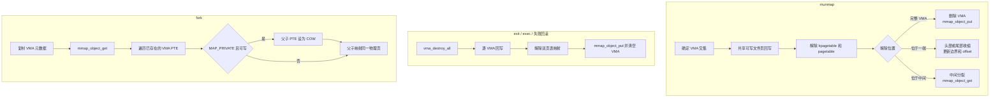
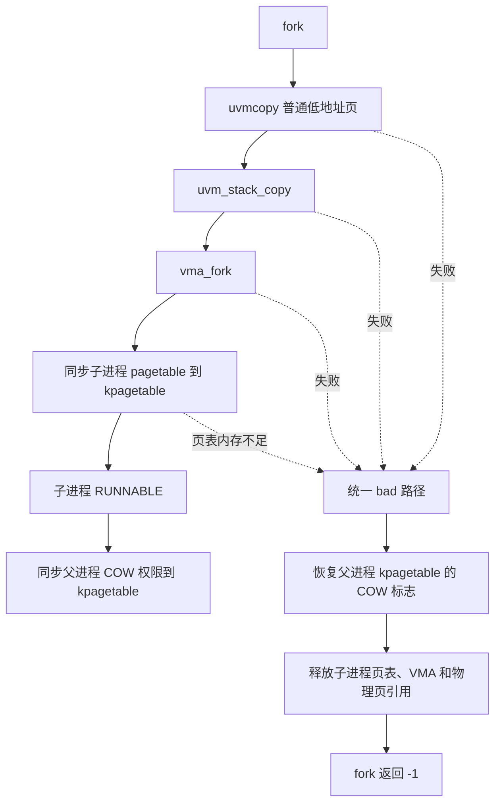

# 缺页异常处理框架

## 1. 文档范围

本文描述当前内核已经实现的统一缺页处理框架，覆盖：

- 用户态指令、读、写产生的 page fault；
- 内核执行 `copyin()`、`copyout()`、`copyinstr()` 时访问用户地址产生的 page fault；
- 普通进程地址空间的 lazy allocation；
- 用户栈按需增长；
- `mmap` 文件、匿名和设备缓冲区的按需映射；
- 普通内存及 `MAP_PRIVATE` 映射在 `fork()` 后的 COW；
- 用户页表 `pagetable` 与进程内核页表 `kpagetable` 的同步；
- 非法访问、物理内存不足和 backing object 失败的边界。

框架的统一入口是：

```c
int vm_resolve_fault(struct proc *p, pagetable_t pagetable,
                     uint64 address, int access);
```

实现位于 `kernel/vm/vmfault.c`。

## 2. 设计目标

缺页处理按五层划分：

| 层次 | 职责 | 主要实现 |
| --- | --- | --- |
| 异常入口层 | 将 RISC-V `scause` 转换为读、写、执行访问；决定失败后的进程策略 | `trap_fault_access()`、`usertrap()`、`kerneltrap()` |
| 地址归属层 | 判断 fault 地址属于 VMA、低地址进程区、用户栈还是非法区域 | `vm_fault_classify()` |
| 状态解析层 | 检查区域权限，区分 present、COW 和 missing PTE | `vm_fault_area_allows()`、`vm_fault_pte_allows()` |
| 后端处理层 | 执行 COW、匿名零页分配或 mmap backing page 获取 | `vm_fault_present()`、`vm_fault_missing()` |
| 页表提交层 | 同步 `pagetable`、`kpagetable` 并刷新 TLB | `vm_sync_user_page()` |

核心约束如下：

1. trap 层不理解 COW、VMA 或物理页来源。
2. 地址归属和访问权限必须先于物理页分配。
3. VMA 对其地址范围拥有完整决策权，VMA 拒绝后不能回退到普通 lazy allocation。
4. present、COW、missing 三条 PTE 路径互斥。
5. backing object 只提供物理页，不决定进程如何处理失败。
6. 成功更新用户 PTE 后必须同步 `kpagetable` 并执行 `sfence_vma()`。
7. 用户态 fault 与内核 copy fault 共用解析框架，但失败策略不同。

文件内容解释：

```text
trap.c：
  负责识别异常来自用户态还是内核态
  负责决定失败后是杀死进程还是恢复 copy 操作

vmfault.c：
  负责地址分类、访问权限、PTE 状态分派

vm.c：
  负责普通堆/栈页面分配和 COW 页面处理

mmap.c：
  负责 VMA 和 mmap 页面缺页

mmap_file.c / mmap_anon.c / mmap_kbuf.c：
  负责不同 backing 类型如何提供实际物理页
```

## 3. 处理框架图

缺页框架按照“入口适配、统一协调、区域处理、页面提供、页表提交、结果策略”组织。`vm_resolve_fault()` 是唯一的通用协调入口，COW、lazy 和 mmap 都是它下面的处理器，不直接进入 trap 层。

```text
┌────────────────────────────── 异常来源 ──────────────────────────────┐
│                                                                     │
│  用户态取指/读/写                         内核 copyin/out/instr      │
│         │                                          │                │
└─────────┼──────────────────────────────────────────┼────────────────┘
          ▼                                          ▼
┌──────────────────────────── 入口适配层 ──────────────────────────────┐
│  usertrap()                              kerneltrap()                │
│      │                         copy_fault_active / recovery PC       │
│      └──────────────────┬───────────────────────────┘                │
│                         ▼                                            │
│  trap_fault_access(): scause 12/13/15 → EXEC/READ/WRITE             │
└─────────────────────────┬────────────────────────────────────────────┘
                          ▼
┌───────────────────────── 统一协调层 ─────────────────────────────────┐
│                    vm_resolve_fault()                               │
│                                                                     │
│  ① 建立 vm_fault_context                                            │
│  ② 校验进程、页表、地址、访问类型                                   │
│  ③ 确定地址归属                                                     │
│  ④ 检查区域权限                                                     │
│  ⑤ 解析 PTE 状态                                                    │
│  ⑥ 选择且只选择一个处理器                                           │
└──────────────┬────────────────────┬────────────────────┬────────────┘
               │                    │                    │
               ▼                    ▼                    ▼
┌──────────────────────┐ ┌──────────────────────┐ ┌──────────────────────┐
│ COW 处理器           │ │ Lazy 处理器          │ │ mmap 处理器          │
│ uvmcowmalloc()       │ │ uvm_fault_alloc()    │ │ mmap_fault_page()    │
│                      │ │                      │ │                      │
│ ref=1: 原地恢复写    │ │ 低地址区: RWX        │ │ 校验 vma->prot       │
│ ref>1: 复制新页      │ │ stack: RW            │ │ 调用 vma->ops->fault │
└──────────┬───────────┘ └──────────┬───────────┘ └──────────┬───────────┘
           │                        │                        │
           │                        │              ┌─────────┴──────────┐
           │                        │              │ 页面提供者         │
           │                        │              │ file / anon private│
           │                        │              │ anon shared / kbuf │
           │                        │              └─────────┬──────────┘
           └────────────────────────┴────────────────────────┘
                                    ▼
┌──────────────────────────── 页表提交层 ──────────────────────────────┐
│  建立或修改 p->pagetable                                            │
│             │                                                       │
│             ▼                                                       │
│  vm_sync_user_page()                                                │
│             │                                                       │
│             ├─ upg2ukpg(): 同步到 p->kpagetable，清除 PTE_U          │
│             └─ sfence_vma(): 刷新 TLB                               │
└─────────────────────────────┬───────────────────────────────────────┘
                              ▼
┌──────────────────────────── 结果策略层 ──────────────────────────────┐
│                                                                     │
│  RESOLVED ──→ 返回异常点，重试原指令                                │
│                                                                     │
│  INVALID / NOMEM / BACKING                                          │
│       ├─ 用户态来源 ──→ p->killed，终止进程                         │
│       └─ 内核 copy  ──→ sepc=copy_fault_recovery，copy 返回 -1      │
│                                                                     │
└─────────────────────────────────────────────────────────────────────┘
```

对应的组件依赖关系如下：



## 4. 异常入口

### 4.1 RISC-V 异常类型

只有以下 page fault 进入可恢复框架：

| `scause` | 访问类型 | 框架值 |
| --- | --- | --- |
| 12 | Instruction page fault | `VM_FAULT_EXEC` |
| 13 | Load page fault | `VM_FAULT_READ` |
| 15 | Store/AMO page fault | `VM_FAULT_WRITE` |

`scause` 1、5、7 是 access fault，不作为普通缺页恢复。它们可能表示总线、PMP 或硬件访问错误，继续重试不能建立合法映射。

### 4.2 用户态入口



用户态缺页不会增加 `epc`。成功后返回同一条指令，由 CPU 重新执行。

### 4.3 内核 copy 入口

`copyin()`、`copyout()` 和 `copyinstr()` 当前通过进程的 `kpagetable` 直接访问用户虚拟地址。访问前设置：

```c
p->copy_fault_active = 1;
p->copy_fault_recovery = (uint64)&&copy_fault;
```

处理流程：



因此，来自用户指针的非法访问不会导致内核 panic；只有不在 copy recovery 区间内的内核异常才进入普通 kernel fault 策略。

## 5. Fault 上下文

统一入口将异常整理为 `vm_fault_context`：

| 字段 | 含义 |
| --- | --- |
| `proc` | 当前进程 |
| `pagetable` | 当前进程用户页表，必须等于 `p->pagetable` |
| `address` | `stval` 原始 fault 地址 |
| `page` | `PGROUNDDOWN(address)` |
| `access` | `READ`、`WRITE` 或 `EXEC` |
| `area` | 地址所属区域 |
| `vma` | mmap 区域对应的 VMA；非 mmap 为 null |
| `pte` | `walk()` 得到的用户 PTE |

入口首先拒绝：

- `p == 0`；
- 传入页表不是当前进程用户页表；
- `address >= MAXUVA`；
- 非法访问类型。

## 6. 地址区域分类

分类顺序是处理边界的一部分，不能随意交换：



### 6.1 VMA 区域

VMA 优先于普通进程区。一旦地址命中 VMA：

- 只能按照 `vma->prot` 判定读、写、执行权限；
- 权限失败直接返回 `VM_FAULT_INVALID`；
- backing 失败不能回退成匿名 heap 页。

这一约束防止只读 mmap 被普通 lazy allocation 错误转换为可写匿名页。

### 6.2 低地址进程区

当前实现以 `address < p->sz` 表示程序映像及 heap 所在的连续低地址空间。missing page 会分配清零页，并建立：

```text
PTE_R | PTE_W | PTE_X | PTE_U
```

这是当前兼容策略；框架已经将权限生成集中在后端，未来可继续细分 text、data 和 heap 权限。

### 6.3 用户栈区

有效 lazy stack 范围为：

```text
[USER_STACK_START, USER_STACK_TOP)
```

其中 `USER_STACK_GUARD` 不在有效范围内。栈页只建立：

```text
PTE_R | PTE_W | PTE_U
```

执行访问会被拒绝。

## 7. PTE 状态机



present PTE 仍然进入 `vm_sync_user_page()`，是为了处理用户页表已经正确、但 `kpagetable` 尚未建立或仍然陈旧的内核 copy fault。

## 8. COW 处理

### 8.1 COW 建立

普通地址空间由 `uvmcopy()` 建立 COW；mmap 地址空间由 `vma_fork()` 建立 COW。对于原本可写的私有页：

```text
父 PTE：清除 PTE_W，设置 PTE_COW
子 PTE：映射同一物理页，清除 PTE_W，设置 PTE_COW
物理页引用计数：加一
```

`MAP_SHARED` 页不设置 COW，父子进程继续映射同一 backing page。

### 8.2 COW 写 fault



引用数为一时不复制页面，这是 COW 的快速路径。

## 9. mmap 处理侧详细框架

mmap 子系统不是单独的缺页函数，而是由映射建立、VMA 管理、缺页取页、页表提交、解除映射和 fork/exit 生命周期共同组成。其核心抽象是：

```text
vma_area       描述一个进程中的虚拟地址区间、权限和映射方式
    │
    ├── mmap_object   持有可跨 VMA、跨 fork 共享的 backing 生命周期
    │
    └── vma_ops       将 missing-page 请求分派给具体页面提供者
```

### 9.1 mmap 总体处理框架图

```text
┌──────────────────────────── mmap 接口层 ────────────────────────────┐
│                                                                    │
│  sys_mmap()                                      sys_munmap()       │
│      │                                                │            │
│      ├─ MAP_ANONYMOUS ─→ vma_map_anon()               │            │
│      ├─ FD_ENTRY      ─→ vma_map_file()               │            │
│      └─ FD_DEVICE     ─→ vma_map_device()             │            │
└──────┬─────────────────────────────────────────────────┼────────────┘
       │ 建立                                            │ 解除
       ▼                                                 ▼
┌──────────────────────────── VMA 管理层 ─────────────────────────────┐
│                                                                    │
│  mmap_map_create()                       vma_unmap()                 │
│  ├─ 参数、权限和 flags 校验              ├─ 范围与 split slot 校验  │
│  ├─ 自顶向下选择空闲地址                 ├─ MAP_SHARED 文件回写     │
│  └─ 写入 p->vmas[NVMA]                   ├─ 双页表解除映射           │
│                                           └─ 删除/收缩/分裂 VMA     │
│                                                                    │
│  mmap_vma_find()：按 fault 地址确定唯一 VMA                        │
└──────────────┬───────────────────────────────┬──────────────────────┘
               │                               │
               ▼                               ▼
┌────────────────────────── VMA 核心对象模型 ─────────────────────────┐
│                                                                    │
│  vma_area                                                          │
│  ├─ [start, end) / valid_end / offset                              │
│  ├─ prot / flags / type                                            │
│  ├─ object ────────────────→ mmap_object                           │
│  └─ ops->fault                    ├─ refcnt + lock                  │
│                                   └─ file / anon_object / kbuf      │
└──────────────┬───────────────────────────────┬──────────────────────┘
               │ missing page                  │ fork/exit/exec
               ▼                               ▼
┌────────────────────────── mmap 缺页协调层 ──────────────────────────┐
│                                                                    │
│  vm_resolve_fault()                                                │
│      └─ VMA 归属和 prot 校验                                       │
│          ├─ present PTE ─→ 普通权限检查或统一 COW 处理              │
│          └─ missing PTE ─→ mmap_fault_page()                        │
│                               ├─ 二次范围/权限/PTE 校验             │
│                               ├─ vma->ops->fault() 获取物理页       │
│                               └─ 根据 vma->prot 生成 PTE 权限       │
└───────────────────────────────┬────────────────────────────────────┘
                                ▼
┌────────────────────────── backing 提供层 ───────────────────────────┐
│                                                                    │
│  file fault             anon private       anon shared      kbuf   │
│  分配零页并读文件       分配独立零页       按 index 查找/    获取设备│
│  尾页只读 valid_end                       创建共享页         缓冲页 │
└───────────────────────────────┬────────────────────────────────────┘
                                ▼
┌──────────────────────────── 页表提交层 ─────────────────────────────┐
│                                                                    │
│  mappages(p->pagetable, page, PGSIZE, pa, PTE_U | prot flags)      │
│       └─ vm_sync_user_page()                                       │
│            ├─ 同步 p->kpagetable，并清除 PTE_U                     │
│            └─ sfence_vma()                                         │
│                                                                    │
│  提交失败：撤销新用户映射并释放本次获得的页面引用                   │
└────────────────────────────────────────────────────────────────────┘
```

框架中的依赖方向如下。VMA 管理层只维护虚拟区间和对象关系；backing 层只提供页面；缺页协调层负责把两者转换成页表映射。



### 9.2 映射建立路径

`sys_mmap()` 根据 flags 和文件类型选择入口，三类入口完成各自的前置约束，再统一调用 `mmap_map_create()`：

| 映射类型 | 创建入口 | 特有校验 | 安装的 backing |
| --- | --- | --- | --- |
| 文件 | `vma_map_file()` | 页对齐 offset、普通文件、可读性；共享可写映射要求文件可写 | `file` + `mmap_file_ops` |
| 私有/共享匿名 | `vma_map_anon()` | 必须设置 `MAP_ANONYMOUS`，fd 为 `-1`，offset 为 `0` | 私有零页或 `anon_object` + `mmap_anon_ops` |
| 设备缓冲区 | `vma_map_device()` | 仅 `MAP_SHARED`、禁止执行、设备提供 mmap 回调 | `kbuf` + `mmap_kbuf_ops` |

`mmap_map_create()` 只承担所有映射共有的工作：

1. 校验 `addr`、`length`、`prot` 和 `MAP_PRIVATE/MAP_SHARED`；
2. 将长度向上按页对齐，并从 `MMAP_TOP` 向低地址查找不与现有 VMA 重叠的区间；
3. 填充 `vma_area`，其中 `end` 是页对齐边界，`valid_end` 是用户请求的真实数据边界；
4. 保存 `offset`、`object` 和 `ops`，但不为普通 lazy mmap 立即建立 PTE。

设备映射可以由驱动设置 `vma->populate`。此时 `mmap_populate()` 预先获取并映射全部页面；成功后清除 `vma->ops`，后续不再允许通过缺页重复取页。

### 9.3 mmap 缺页处理路径



`mmap_fault_page()` 只处理 missing VMA page。present PTE、COW 和第一轮区域权限检查属于统一缺页核心；mmap 侧再次检查范围和权限，是后端入口自身的防御边界。VMA 一旦命中但权限或 backing 失败，不允许回退成 heap/stack lazy page。

PTE 权限直接由 VMA 权限生成：

```text
PROT_READ  -> PTE_R
PROT_WRITE -> PTE_W
PROT_EXEC  -> PTE_X
所有用户 mmap 页始终增加 PTE_U
```

### 9.4 backing 页面提供框架

| VMA 类型 | `fault` 行为 | 页面共享与所有权 | 回收方式 |
| --- | --- | --- | --- |
| 文件映射 | 分配并清零一页，按 `vma->offset + page - start` 读取；超过 `valid_end` 的尾部保持为零 | 新 fault 页由当前 PTE 持有；fork 时已存在的私有可写页进入 COW | PTE 解除映射时减少页面引用；object 销毁时关闭文件引用 |
| 私有匿名 | 每次 missing fault 分配独立清零页 | 当前地址空间私有；fork 后已存在的可写页进入 COW | PTE 解除映射时释放引用 |
| 共享匿名 | 使用 object 内页索引查找或创建共享页 | `anon_object` 持有一份引用，各 PTE 各持有一份引用 | PTE 释放各自引用；object 最后销毁时释放索引页引用 |
| 设备 kbuf | 按 VMA offset 和页号取得预分配设备缓冲页 | kbuf object 与映射 PTE 通过引用计数共享 | PTE 先释放映射引用；object 最后销毁时释放 kbuf |

backing provider 的统一契约是：成功时通过 `*mem` 返回一个已由调用方持有引用的物理页，失败返回 `-1`。provider 不建立 PTE、不修改 `p->kpagetable`，也不决定是否终止进程。

### 9.5 munmap、退出与 fork 生命周期



生命周期边界如下：

1. `vma_unmap()` 在修改 VMA 和拆页表之前完成共享文件页回写；回写失败时保留原映射结构。
2. 解除映射同时处理 `kpagetable` 和 `pagetable`，物理页只由用户 PTE 的解除路径减少引用。
3. 中间区间解除映射会分裂 VMA，并为新 VMA 增加一份 object 引用；头部收缩必须同步增加 `offset`。
4. `vma_destroy_all()` 用于退出、exec 和失败回滚：回写、拆页、释放 object，最后清空 VMA。
5. `vma_fork()` 复制 VMA 并增加 object 引用。`MAP_PRIVATE` 的已映射可写页转为 COW；`MAP_SHARED` 页继续共享物理页。
6. 尚未触页的 VMA 不复制 PTE，子进程以后仍通过同一套 `vma_ops` 独立处理 missing fault。

### 9.6 mmap 侧返回边界

| 失败位置 | 返回结果 | 处理责任 |
| --- | --- | --- |
| VMA 范围错误、访问权限错误或 present PTE 权限冲突 | `VM_FAULT_INVALID` | trap 根据用户态或内核 copy 来源选择 kill/recovery |
| `vma_ops` 缺失或 backing 无法提供页面 | `VM_FAULT_BACKING` | 不回退到普通 lazy allocation |
| 用户 PTE 建立失败或双页表同步失败 | `VM_FAULT_NOMEM` | mmap 侧回滚本次页面，trap 决定失败策略 |
| 页面和双页表均提交完成 | `VM_FAULT_RESOLVED` | 返回异常点重试原访问 |

## 10. 页表提交与回滚

每个进程维护两套相关页表：

```text
p->pagetable   用户态运行使用，用户页包含 PTE_U
p->kpagetable  内核执行该进程时使用，映射同一用户物理页但清除 PTE_U
```

统一提交函数：

```c
int vm_sync_user_page(struct proc *p, uint64 va)
{
  page = PGROUNDDOWN(va);
  upg2ukpg(p->pagetable, p->kpagetable, page, page + PGSIZE);
  sfence_vma();
}
```

提交规则：

1. 先建立或修改用户 PTE；
2. 将同一 PTE 内容复制到 `kpagetable`，同时清除 `PTE_U`；
3. 执行 `sfence_vma()`；
4. 返回 `VM_FAULT_RESOLVED`。

lazy allocation 和 mmap 在同步失败时撤销新建的用户映射并释放页面。COW 同步失败当前被视为内核页表一致性错误并 panic，因为用户 PTE 已经发生替换，不能简单丢弃新页。

## 11. 返回结果与失败策略

| 结果 | 含义 | 用户态 fault | 内核 copy fault |
| --- | --- | --- | --- |
| `VM_FAULT_RESOLVED` | 页面和权限已经就绪 | 返回并重试原指令 | 返回并重试 copy 指令 |
| `VM_FAULT_INVALID` | 地址、区域或权限非法 | 标记 killed，终止进程 | 跳转 recovery，返回 `-1` |
| `VM_FAULT_NOMEM` | 物理页或页表页不足 | 标记 killed，终止进程 | 跳转 recovery，返回 `-1` |
| `VM_FAULT_BACKING` | 文件或设备 backing 无法提供页面 | 标记 killed，终止进程 | 跳转 recovery，返回 `-1` |

框架返回原因，trap 决定策略。这样 VM 核心不直接操作 `p->killed`，也不修改异常返回 PC。

## 12. fork 与缺页框架的关系



子进程页表同步发生在复制文件描述符和 cwd 引用之前，因此页表内存不足时可以完整回滚。资源不足属于正常 `fork()` 失败，不允许触发 kernel panic。

## 13. 边界与不变量

### 13.1 地址边界

- `address >= MAXUVA`：非法；
- VMA 外且 `address >= p->sz`，又不在用户栈范围：非法；
- `USER_STACK_GUARD`：非法；
- mmap 权限失败：非法，禁止回退；
- stack execute：非法。

### 13.2 PTE 边界

- 用户可访问的 present PTE 必须包含 `PTE_U`；
- 写 COW 只允许发生在区域本身允许写的前提下；
- 非 COW 的权限 fault 不允许通过重新映射绕过；
- missing page 才能进入 backing allocation。

### 13.3 生命周期边界

- `uvmunmap()`、进程退出和 `exec()` 必须同步拆除用户页表及 `kpagetable` 映射；
- 物理页释放通过引用计数完成，COW、共享匿名页和 kbuf 不能直接无条件释放；
- fork 失败必须恢复父进程页表权限，并释放子进程已经获得的全部引用。

## 14. 当前验证覆盖

当前框架在双核 QEMU、8 MiB 内存配置下通过：

| 测试 | 覆盖重点 | 结果 |
| --- | --- | --- |
| `memlayouttest` | VMA/heap/stack 边界、guard、fork、exec | 通过 |
| `mmaptest` | 文件、匿名、共享、设备 mmap，权限、copy fault、fork | 全部通过 |
| `cowtest` | 普通 COW、多人共享、copyout COW | `ALL COW TESTS PASSED` |
| `lazytests` | 稀疏 lazy allocation、unmap、OOM | `ALL TESTS PASSED` |
| `kalloctest` | 并发分配、反复 OOM 回收、物理页泄漏 | `test1/test2 OK` |
| `sysinfotest` | lazy 触页后的物理内存统计与回收 | `OK` |
| `forktest` | 进程/页表资源耗尽时的 fork 回滚 | `OK` |
| `usertests` | copy、sbrk、stack、非法地址及全局泄漏回归 | `ALL TESTS PASSED` |

测试中的部分 `page fault is illegal` 日志是 guard page、权限测试或 OOM 子进程主动触发的预期结果。

## 15. 扩展新缺页类型的方法

新增 zero page、swap 或新的 mmap backing 时，应保持以下扩展边界：

1. 在地址归属层增加明确的区域或 VMA 属性；
2. 在 missing-page 后端增加页面来源；
3. 后端返回物理页或明确失败，不直接杀死进程；
4. 通过统一页表提交层安装映射；
5. 保持用户 fault 与 kernel copy fault 的策略分离；
6. 为 present、missing、权限错误、OOM、fork 和回收分别增加测试。

不要在 `usertrap()` 或 `kerneltrap()` 中直接加入新的 COW、mmap 或分配分支，也不要让 VMA 失败回退到普通匿名页。
